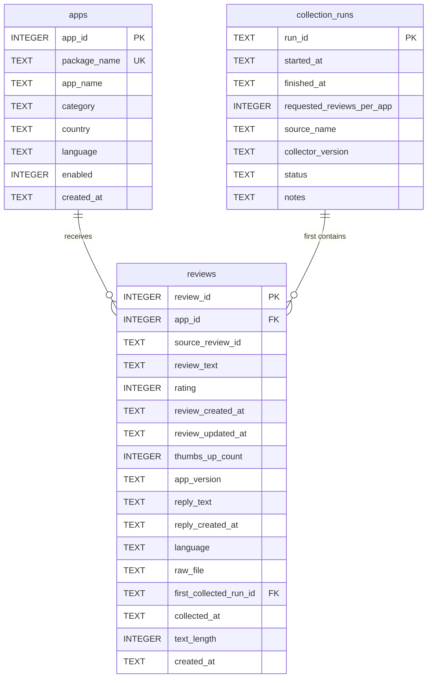

# Database schema: Google Play review ingestion prototype

This document formalizes the SQLite design implemented in
[`src/schema.sql`](../src/schema.sql). It documents the tables, keys, field
types, relationships, Google Play field mapping, and the design choices used
for the Phase I prototype.

The design intentionally remains small and reviewable: it separates app-level
metadata, source collection batches, and individual reviews. It is designed
for the existing US/English, newest-first Google Play collection and does not
claim to represent the whole Google Play population.

## Entity relationship diagram



Relationship summary:

- One `apps` row may have zero or many `reviews`; every review has one app.
- One `collection_runs` row may have zero or many `reviews`; every stored
  review refers to the source collection run in which it was first inserted.
- `(app_id, source_review_id)` is unique. This prevents the same Google Play
  review from being stored twice for the same app and makes reloads safe.

## Tables and fields

SQLite stores dates and timestamps as ISO 8601 `TEXT`. `NULL` means a value is
not guaranteed by the source; `NOT NULL` identifies data needed for a usable
review record.

### `apps`

One row per Google Play package. `package_name` is the stable natural key from
the app configuration; `app_id` is the internal surrogate key used in joins.

| Column | Type | Key / rule | Description |
| --- | --- | --- | --- |
| `app_id` | INTEGER | Primary key | Internal app identifier. |
| `package_name` | TEXT | Required, unique | Google Play package identifier. |
| `app_name` | TEXT | Required | Display name from `config/apps.csv`. |
| `category` | TEXT | Required | Project-defined analysis category. |
| `country` | TEXT | Required | Requested storefront country, e.g. `us`. |
| `language` | TEXT | Required | Requested collection language, e.g. `en`. |
| `enabled` | INTEGER | Required; 0 or 1 | Whether an app is enabled in the database configuration. |
| `created_at` | TEXT | Required; default UTC time | When the row was first inserted. |

### `collection_runs`

One row per source collection run. `run_id` is the value written by
`collect_reviews.py` to each record's `_ingestion.run_id`; it is not a database
loader invocation ID.

| Column | Type | Key / rule | Description |
| --- | --- | --- | --- |
| `run_id` | TEXT | Primary key | Source collection batch identifier. |
| `started_at` | TEXT | Required | Earliest retained collection timestamp for the run. |
| `finished_at` | TEXT | Optional | Latest retained collection timestamp for the run. |
| `requested_reviews_per_app` | INTEGER | Optional; > 0 when known | Target passed to the collector (for example, 500). It is nullable for legacy raw files that did not record it. |
| `source_name` | TEXT | Required | Source/tool label, currently `google_play_unofficial_google_play_scraper`. |
| `collector_version` | TEXT | Optional | Collector package/version if captured in a future run. |
| `status` | TEXT | Required; completed/partial/failed | Recorded batch state. The current loader marks runs with retained records as `completed`. |
| `notes` | TEXT | Optional | Brief provenance note. |

### `reviews`

One row per retained Google Play review. The source review identifier is only
unique inside an app, so its uniqueness rule includes `app_id`.

| Column | Type | Key / rule | Description |
| --- | --- | --- | --- |
| `review_id` | INTEGER | Primary key | Internal review identifier. |
| `app_id` | INTEGER | Required foreign key to `apps` | App that received the review. |
| `source_review_id` | TEXT | Required; unique with `app_id` | Google Play `reviewId`. |
| `review_text` | TEXT | Required | Cleaned review content. |
| `rating` | INTEGER | 1–5 when present | Google Play star score. |
| `review_created_at` | TEXT | Optional | Google Play review timestamp. |
| `review_updated_at` | TEXT | Optional | Google Play update timestamp, if supplied. |
| `thumbs_up_count` | INTEGER | Non-negative when present | Helpful-vote count. |
| `app_version` | TEXT | Optional | Version reported with the review. |
| `reply_text` | TEXT | Optional | Developer response content. |
| `reply_created_at` | TEXT | Optional | Developer response timestamp. |
| `language` | TEXT | Optional | Requested scraper language, not automatically detected review language. |
| `raw_file` | TEXT | Required | JSONL source file name for traceability. |
| `first_collected_run_id` | TEXT | Required foreign key to `collection_runs` | Source run that first inserted this review. |
| `collected_at` | TEXT | Required | Per-record collection timestamp. |
| `text_length` | INTEGER | Required; non-negative | Character length after cleaning. |
| `created_at` | TEXT | Required; default UTC time | When the database row was first inserted. |

The schema indexes `reviews.app_id`, `reviews.rating`, and
`reviews.review_created_at` for common app, rating, and time queries.

## Google Play source-to-database mapping

`collect_reviews.py` adds `_ingestion` metadata to every raw JSONL record.
`clean_reviews.py` validates and normalizes those records into a cleaned CSV;
`load_database.py` loads the normalized values into SQLite.

| Source / cleaned field | Database destination | Handling |
| --- | --- | --- |
| `config/apps.csv`: package name, app name, category, country, language | `apps` | Upserted by `package_name`. |
| Google Play `reviewId` | `reviews.source_review_id` | Required; unique within an app. |
| Google Play `content` | `reviews.review_text`, `reviews.text_length` | Whitespace normalized; blank records rejected; length derived after cleaning. |
| Google Play `score` | `reviews.rating` | Converted to integer; values outside 1–5 rejected. |
| Google Play `at` | `reviews.review_created_at` | Normalized to ISO 8601 UTC; missing/invalid values become `NULL`. |
| Google Play `updated` | `reviews.review_updated_at` | Normalized to ISO 8601 UTC; optional. |
| Google Play `thumbsUpCount` | `reviews.thumbs_up_count` | Missing values become 0; negatives are clipped to 0. |
| Google Play `reviewCreatedVersion` | `reviews.app_version` | Optional text. |
| Google Play `replyContent` | `reviews.reply_text` | Whitespace normalized; blank response becomes `NULL`. |
| Google Play `repliedAt` | `reviews.reply_created_at` | Normalized to ISO 8601 UTC; optional. |
| `_ingestion.run_id` | `collection_runs.run_id`, `reviews.first_collected_run_id` | Preserves source-batch lineage. |
| `_ingestion.collected_at` | `reviews.collected_at`; run start/end | Retains record time; run times are derived from retained records. |
| `_ingestion.source` | `collection_runs.source_name` | Identifies the collection method. |
| `_ingestion.requested_reviews_per_app` | `collection_runs.requested_reviews_per_app` | Captured by new collections; nullable for legacy files. |
| Raw JSONL file name | `reviews.raw_file` | File-level provenance. |

## Main design choices

- **Normalize at the app level.** App name, category, country, and language
  are stored once in `apps`, rather than repeated on every review.
- **Use both internal and source identifiers.** Numeric `review_id` gives the
  database a simple primary key, while `(app_id, source_review_id)` supports
  idempotent loads and source-level deduplication.
- **Treat sparse metadata as optional.** EDA found that app-version coverage
  was incomplete and developer replies were much less common. `app_version`,
  `reply_text`, and `reply_created_at` are nullable; downstream users must not
  assume those fields exist on every review.
- **Keep collection provenance without over-designing.** Each review links to
  its first source batch and raw file. This is sufficient to trace the Phase I
  prototype without adding separate tables for reviewers, replies, or
  categories.
- **Use SQLite for the prototype.** It makes the normalized data queryable and
  reviewable with no server administration. PostgreSQL remains a practical
  future migration if concurrency, volume, or access controls increase.

## Known limits and interpretation

- The collector uses the unofficial third-party `google-play-scraper` library,
  not an official Google API. Source availability and fields may change.
- The Phase I data is a fixed newest-first sample from selected US/English
  apps. Differences by app or category are descriptive, not estimates for all
  Google Play reviews.
- A collection run with no retained reviews (for example, the Coursera result)
  does not produce a `collection_runs` row because the current prototype
  derives run records from retained cleaned reviews. A future production
  collector could add a separate run manifest to capture zero-result and failed
  apps explicitly.

## Verification

Run the database load and checks from the repository root:

```bash
python src/load_database.py
python src/verify_database.py
```

The verification script reports category counts, invalid required values,
duplicate source keys, optional-metadata coverage, and foreign-key violations.
For a non-default database location, pass `--database path/to/reviews.sqlite`.
